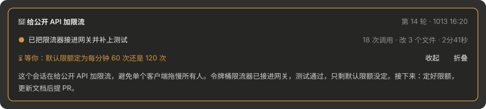

[English](README.md) | 简体中文

# tyler-claude-mods

我自己在用的 [Claude Code mods](https://claude.dev/blog/getting-started-with-claude-code-mods/)：hooks 模块在 Claude Code 里运行的 plugin，需要 Claude Code 2.1.287 或更高版本。每个 mod 是 `mods/` 下的一个独立 plugin，仓库根目录的 `.claude-plugin/marketplace.json` 把它们登记为一个 marketplace。

| Mod | 作用 | 界面 |
| --- | --- | --- |
| [where-am-i](mods/where-am-i/README.zh-CN.md) | 输入框上方的会话摘要卡片：目标、现在、下一步、等你处理的事。跨重启保留，可展开详情、折叠成胶囊 | desktop、terminal |
| [session-title](mods/session-title/README.zh-CN.md) | 用 Haiku 按「前缀｜MMDD｜主体」规则自动维护会话标题，主线偏离时跟着更新 | desktop、terminal |



## 安装

在终端的 Claude Code 里（desktop 的 Code 标签页不支持 `/plugin install`，在终端装好后 desktop 会话也会加载）：

```
/plugin install where-am-i --marketplace tyler4400/tyler-claude-mods
```

或者在 shell 里：

```bash
claude plugin marketplace add tyler4400/tyler-claude-mods
claude plugin install where-am-i@tyler-claude-mods --scope user
```

装好后新开会话，或在已打开的会话里运行 `/reload-plugins`。

## 安全

mod 不在沙箱里运行，权限和 Claude Code 一样。安装前可以先读源码，或用下面的命令列出它注册了哪些 hook、调用了哪些接口：

```bash
claude plugin validate mods/where-am-i
```

## 开发

```bash
claude plugin validate mods/<name>   # 检查 manifest 和 hooks 模块
claude plugin test mods/<name>       # 跑 *.test.ts
```

本机把这个目录加为 marketplace（`claude plugin marketplace add <本目录>`）后安装。`/reload-plugins` 会重新读取目录，但重启 app 后加载的是安装时的缓存副本，所以改完代码要升 `plugin.json` 的版本，再运行 `claude plugin update <name>@tyler-claude-mods`。

## License

MIT。where-am-i fork 自 [hamzafer/claude-code-mods](https://github.com/hamzafer/claude-code-mods) 的同名 mod（MIT，Copyright (c) 2026 Hamza Zafar）。
