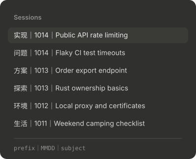
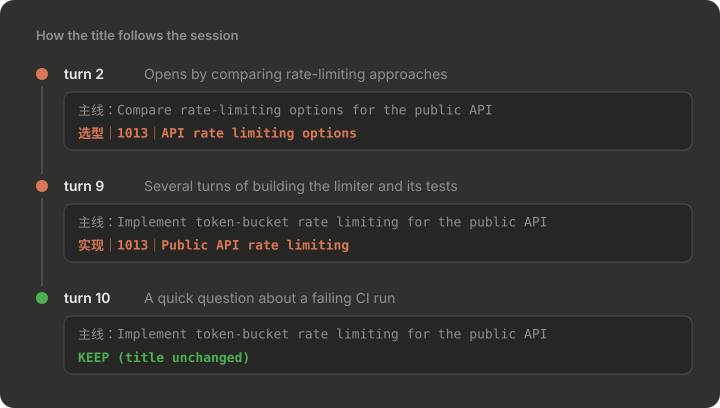

English | [简体中文](README.zh-CN.md)

# session-title

After each turn, Haiku checks the session title against the rules in [title-rules.md](title-rules.md). Titles take the form `前缀｜MMDD｜主体` (prefix｜month-day｜subject), for example `探索｜1013｜ClaudeCode mods调研`. The rules are written for Chinese titles; edit them to suit your own style.





The screenshots are drawn from sample data by [docs/render_screenshots.py](docs/render_screenshots.py).

- **Checked every turn**: the model first writes one line on what the session is **working on now**, then decides whether to keep or change the title. If the opening topic has been replaced by work that has gone on for several turns (say, from surveying mods to rewriting and publishing one), the subject is rewritten. A question, error or detour that lasts a turn or two does not count.
- **Stable by default**: the title is kept when it is well formed, dated today and still names what the session is working on.
- If you reject a subject change once, the subject is locked and only the prefix and date are adjusted from then on. If you reject that too, it stops trying for that session.
- In the desktop app it sets the title with the app's own session tools; in a terminal it writes the title through a hook the next time you submit a prompt.
- It calls Haiku, so it adds nothing to the main model's context, but the calls count toward your usage.
- Records live in `$.store` (`~/.claude/plugins/store/`); records not updated for 30 days are removed.

## Install

```
/plugin install session-title --marketplace tyler4400/tyler-claude-mods
```

Or:

```bash
claude plugin marketplace add tyler4400/tyler-claude-mods
claude plugin install session-title@tyler-claude-mods --scope user
```

The rules are in [title-rules.md](title-rules.md); change the prefix list to match your own habits.
