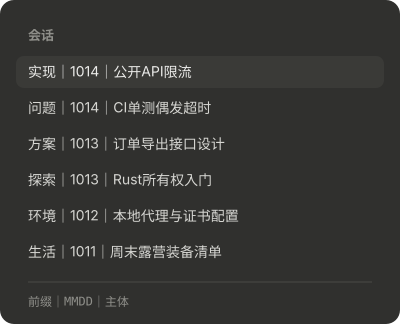
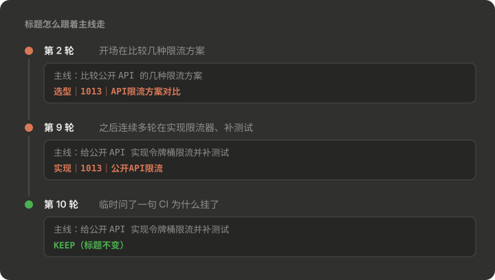

[English](README.md) | 简体中文

# session-title

每轮结束后用 Haiku 按 [title-rules.md](title-rules.md) 的规则检查会话标题，格式为 `前缀｜MMDD｜主体`，例如 `探索｜1013｜ClaudeCode mods调研`。





截图用示例数据画出，由 [docs/render_screenshots.py](docs/render_screenshots.py) 生成。

- 每轮都检查：模型先用一句话写出会话**现在持续在做的事**，再决定保持还是改。开场话题被后来持续多轮的工作取代（比如从调研 mods 变成改写并发布某个 mod），就改主体；一两轮的临时插问、报错不算偏离。
- 稳定优先：格式对、日期是今天、标题仍说得出现在在做的事时保持不变。
- 你拒绝过一次改主体后，主体会被锁定，之后只调整前缀和日期；连这个也被拒绝，本会话就不再尝试。
- desktop app 里通过 app 自带的会话管理工具改标题；终端里通过下一次提交 prompt 时的 hook 写入。
- 调用的是 Haiku，不占主模型上下文，但会计入用量。
- 记录存在 `$.store`（`~/.claude/plugins/store/`），30 天没更新的会话记录会被清理。

## 安装

```
/plugin install session-title --marketplace tyler4400/tyler-claude-mods
```

或者：

```bash
claude plugin marketplace add tyler4400/tyler-claude-mods
claude plugin install session-title@tyler-claude-mods --scope user
```

规则在 [title-rules.md](title-rules.md)，可以按自己的习惯修改前缀池。
