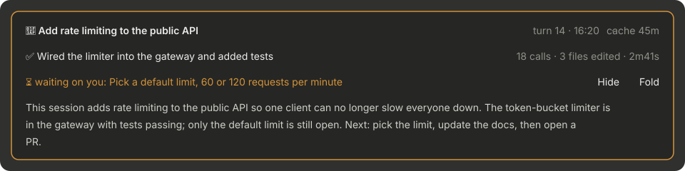
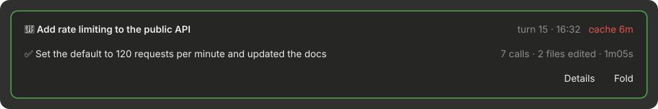

English | [简体中文](README.zh-CN.md)

# status-card

[](https://modscode.com/claude-mods/mods/tyler4400-status-card/)

A recap card above the Claude Code prompt: the goal, what is happening now, and what waits on you. The recap is saved per conversation, so it is still there after you restart the app or open a session from days ago. Made for long sessions: step away, come back, and pick up where you left off at a glance.





> Built on the source of [where-am-i](https://github.com/hamzafer/claude-code-mods/tree/main/mods/where-am-i) by [hamzafer](https://github.com/hamzafer). See [Credits](#credits).

The screenshots are drawn from sample data by [docs/render_screenshots.py](docs/render_screenshots.py).

## What the card shows

Always three lines:

1. **🎯 Goal**: the mainline of the whole session. It changes only when you move on to different work. On the right: **turn N · last update** (while working, N is the turn in progress; `HH:mm` for today, `MMDD HH:mm` for other days, e.g. `1013 20:06`). When it is your turn, the **cache hint** follows the time; see below.
2. **Now**: while Claude works, a dot in the working colour and **This turn: what it is doing**, in one phrase; after the turn, **✅** and what the turn did. On the right: **calls · files edited · elapsed**. It ticks every second while Claude works, then keeps the turn's final numbers, even after a restart. It does not repeat the per-tool status Claude Code already shows.
3. **⏳ waiting on you**: what Claude needs from you. Empty while Claude works (line 2 already says what it is doing) and when nothing waits on you. On the right: the **Details** and **Fold** buttons.

When the window gets narrow, the turn, time, cache hint, stats and buttons on the right stay whole and the text on the left is cut instead.

- **Cache hint**: how long Claude's prompt cache has left, e.g. `● cache 45m`. Green with more than 10 minutes left, yellow within 10 minutes, red with `cache expired` once it lapses. Carrying on while the cache is warm saves rewriting the whole context into it. It counts from when the main thread's last request was sent; the lifetime (5 minutes or 1 hour) is read from this session's transcript, and when it cannot be read the hint is not shown. It is kept per model: switching to a model this session has not used yet shows it expired, and switching back shows the original model's time left. A cache last used on another day (say, looking back at yesterday's session) is not shown. Shown only when it is your turn, not while Claude works.

- **The border colour** shows the state: working, waiting on you, or idle.
- **Details**: for when you come back and have forgotten what the session was about. One paragraph of two or three sentences (at most 90 English words or 180 Chinese characters): the mainline and why, how far it got, and what to do next, including to-dos agreed but not done yet. It starts from the mainline, not from the latest small problem. It is drawn in the card only and **never enters the conversation**. It is cached per turn and only rewritten after a new turn; while it is open, a new turn refreshes it.
- **Fold**: shrinks the card to a one-line capsule showing one thing: while Claude works, a dot in the working colour and what it is doing this turn; when something waits on you, ⏳ and what it is; otherwise ✅ and the goal; on the right the update time, then the elapsed time while Claude works or the cache hint when it is your turn, and an **Unfold** button. The capsule is as wide as its content and at most one full line; when it does not fit, the text on the left is cut first. The fold state is kept across sessions.

## Install

In Claude Code in a terminal:

```
/plugin install status-card --marketplace tyler4400/tyler-claude-mods
```

Or from a shell:

```bash
claude plugin marketplace add tyler4400/tyler-claude-mods
claude plugin install status-card@tyler-claude-mods --scope user
```

The card appears as soon as you send your first message; until the first recap is ready, the goal line reads "The goal is summarized when this turn ends". If you install it in the middle of a turn, that turn's card has no call count or elapsed time on the right; they show from the next turn.

**Upgrading from where-am-i or goal-card:** these are earlier names of this mod. Uninstall the old one, then install status-card. Recaps are stored per plugin name, so old recaps do not carry over.

```bash
claude plugin uninstall where-am-i@tyler-claude-mods   # or goal-card@tyler-claude-mods
claude plugin install status-card@tyler-claude-mods --scope user
```

## Configuration

Change these in `/config` or `/plugin configure status-card@tyler-claude-mods`. Changes apply right away.

| Option | Default | Meaning |
| --- | --- | --- |
| `language` | `auto` | Recap language: `auto` follows the latest messages you typed (Chinese or English); background notifications and messages from other sessions do not count; `zh`; `en` |
| `model` | `haiku` | Model that writes the recap and the details |
| `accentColor` | `suggestion` | Colour while working: a theme colour name (`suggestion`, `claude`, `success`, `warning`, `error`, …) or `#hex` |
| `waitingColor` | `warning` | Colour while waiting on you |
| `idleColor` | `success` | Colour while idle |
| `borderStyle` | `round` | Card border: `round`, `single`, `bold`, `double`, `none` |
| `density` | `comfortable` | Line spacing: `comfortable` leaves a blank row between lines; `compact` does not |
| `showMeta` | `true` | Show "turn N · time" |
| `retentionDays` | `30` | Recaps not updated for this many days are removed |

## How it works

**Two model calls per turn.** When you send a message, one `haiku` call writes the "This turn: …" phrase from your message (first 1000 + last 500 characters) and the previous recap. Output is capped at 80 tokens.

After each turn of the main conversation, another `haiku` call updates the recap. Its input is:

- the previous recap and **a running summary of the whole session** (updated every turn from the previous one, about 400 characters at most: the mainline, milestones reached, the current small problem, open to-dos);
- every message you sent in the session, the first 150 characters of each; past 15 messages it keeps the first 3 and the latest 12. This is how it tells the mainline from the problem at hand;
- your message for this turn (first 1000 + last 500 characters);
- short labels for this turn's tool calls (a command's description or first 60 characters, file paths, search terms);
- Claude's reply (first 1500 + last 1500 characters).

Long text keeps its head and tail with a note saying how much was cut, and the model is told the cut is on purpose so it does not treat the text as incomplete. Output is capped at 700 tokens.

**Opening the details** makes one more call. Its input is the running summary, the latest card, every message you sent (as above) and the last 6 messages (first 600 + last 600 characters each). It writes two or three sentences, capped at 400 tokens.

These are real model requests and count toward your usage.

**Where the data lives:** in `$.store`, which Claude Code gives each plugin as a JSON file under `~/.claude/plugins/store/`. There is one record per session (latest recap, running summary, turn, update time, language, last turn's stats, cached details) and one prompt-cache state (each model's last request time and cache lifetime), plus the fold preference. Records not updated for `retentionDays` are removed when a session starts.

Records are keyed by session id: resuming and compaction keep the id, so the card comes back as it was. A session opened by forking, or by right-clicking and choosing Start a side chat, gets a new id; its transcript starts with entries copied from the original, which still carry the original session's id, so status-card copies the original's card and the two update separately from then on. Records 0.5.x stored under a fingerprint of the working directory and first message are migrated only through the session-id mapping recorded at the time.

**What it does and does not do:** the `tool.call` hook only watches. Every call goes through unchanged; it counts calls and the files edited by Edit or Write. It does not change your messages or Claude's replies. Apart from the model calls above, it runs `date +%z` once per session to get the local time zone, and, when the current session has no card yet, `grep`s the `sessionId` values out of that session's own transcript to find the original session of a fork or side chat; at the end of each turn it runs `grep` and `tail` to read the last few transcript lines containing `ephemeral_`, which give the lifetime the request wrote the prompt cache with. It makes no other network requests and otherwise reads or writes no files outside its store.

Hooks: `session.start`, `classic.SessionStart`, `classic.UserPromptSubmit`, `classic.PostModelSwitch`, `session.end`, `prompt.submit`, `tool.call`, `turn.step` (only to note when each request is sent), `turn.complete`, `ui.render` (`AbovePrompt`).

## Limitations

- Finding the original session of a fork or side chat reads its transcript. If Claude Code changes the transcript format, such a session starts with an empty card rather than picking up another conversation's.
- The cache lifetime is read from the transcript's `usage.cache_creation`. If Claude Code changes the transcript format, the cache hint stops showing rather than showing a wrong time. The time left is worked out from the last request, not asked of the API; requests sent to the same conversation from elsewhere (another process resuming it) are not seen here.
- If a model call fails or returns something malformed, the previous recap stays.
- The turn number counts your messages with text in the session, slash commands included. After compaction it keeps counting up and never goes back.
- Drawn only in Claude Code's desktop app and terminal; not in the VS Code extension or `claude -p`.
- Checked with `claude plugin validate` and `claude plugin test` on Claude Code 2.1.294 / 2.1.295 / 2.1.299.

## Credits

Built on the source of [where-am-i](https://github.com/hamzafer/claude-code-mods/tree/main/mods/where-am-i) in [hamzafer/claude-code-mods](https://github.com/hamzafer/claude-code-mods) (MIT, Copyright (c) 2026 Hamza Zafar). It was called where-am-i here too and was renamed status-card to avoid clashing with the original. This version turns it into a card and adds persistence, the running summary, language following, details, folding and options.
