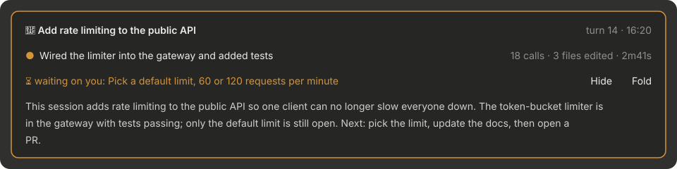
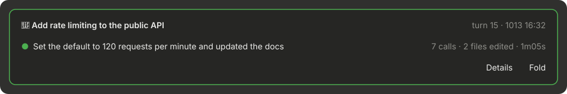

English | [简体中文](README.zh-CN.md)

# where-am-i

A recap card above the Claude Code prompt: the goal, what is happening now, and what waits on you. The recap is saved per conversation, so it is still there after you restart the app or open a session from days ago. Made for long sessions: step away, come back, and pick up where you left off at a glance.





The screenshots are drawn from sample data by [docs/render_screenshots.py](docs/render_screenshots.py).

## What the card shows

Always three lines:

1. **🎯 Goal**: the mainline of the whole session. It changes only when you move on to different work. On the right: **turn N · last update** (`HH:mm` for today, `MMDD HH:mm` for other days, e.g. `1013 20:06`).
2. **● Now**: while Claude works, **This turn: what it is doing**, in one phrase; after the turn, what the turn did. On the right: **calls · files edited · elapsed**. It ticks every second while Claude works, then keeps the turn's final numbers, even after a restart. It does not repeat the per-tool status Claude Code already shows.
3. **⏳ waiting on you**: what Claude needs from you. Empty while Claude works (line 2 already says what it is doing) and when nothing waits on you. On the right: the **Details** and **Fold** buttons.

When the window gets narrow, the turn, time, stats and buttons on the right stay whole and the text on the left is cut instead.

- **The border colour** shows the state: working, waiting on you, or idle.
- **Details**: for when you come back and have forgotten what the session was about. One paragraph of two or three sentences (at most 90 English words or 180 Chinese characters): the mainline and why, how far it got, and what to do next, including to-dos agreed but not done yet. It starts from the mainline, not from the latest small problem. It is drawn in the card only and **never enters the conversation**. It is cached per turn and only rewritten after a new turn; while it is open, a new turn refreshes it.
- **Fold**: shrinks the card to a one-line capsule: state dot, goal, waiting mark, turn, update time, the calls · files · elapsed stats, and an **Unfold** button. The capsule is as wide as its content and at most one full line; when it does not fit, the goal is cut first. The fold state is kept across sessions.

## Install

In Claude Code in a terminal:

```
/plugin install where-am-i --marketplace tyler4400/tyler-claude-mods
```

Or from a shell:

```bash
claude plugin marketplace add tyler4400/tyler-claude-mods
claude plugin install where-am-i@tyler-claude-mods --scope user
```

The card appears after the first turn ends.

## Configuration

Change these in `/config` or `/plugin configure where-am-i@tyler-claude-mods`. Changes apply right away.

| Option | Default | Meaning |
| --- | --- | --- |
| `language` | `auto` | Recap language: `auto` follows your latest messages (Chinese or English); `zh`; `en` |
| `model` | `haiku` | Model that writes the recap and the details |
| `accentColor` | `suggestion` | Colour while working: a theme colour name (`suggestion`, `claude`, `success`, `warning`, `error`, …) or `#hex` |
| `waitingColor` | `warning` | Colour while waiting on you |
| `idleColor` | `success` | Colour while idle |
| `borderStyle` | `round` | Card border: `round`, `single`, `bold`, `double`, `none` |
| `density` | `comfortable` | Line spacing: `comfortable` leaves a blank row between lines; `compact` does not |
| `showMeta` | `true` | Show "turn N · time" |
| `retentionDays` | `30` | Recaps not updated for this many days are removed |

## How it works

**Two model calls per turn.** When you send a message, one `haiku` call writes the "This turn: …" phrase from your message (first 1000 + last 500 characters) and the previous recap. Output is capped at 80 tokens.

After each turn of the main conversation, another `haiku` call updates the recap. Its input is:

- the previous recap and **a running summary of the whole session** (updated every turn from the previous one, about 400 characters at most: the mainline, milestones reached, the current small problem, open to-dos);
- every message you sent in the session, the first 150 characters of each; past 15 messages it keeps the first 3 and the latest 12. This is how it tells the mainline from the problem at hand;
- your message for this turn (first 1000 + last 500 characters);
- short labels for this turn's tool calls (a command's description or first 60 characters, file paths, search terms);
- Claude's reply (first 1500 + last 1500 characters).

Long text keeps its head and tail with a note saying how much was cut, and the model is told the cut is on purpose so it does not treat the text as incomplete. Output is capped at 700 tokens.

**Opening the details** makes one more call. Its input is the running summary, the latest card, every message you sent (as above) and the last 6 messages (first 600 + last 600 characters each). It writes two or three sentences, capped at 400 tokens.

These are real model requests and count toward your usage.

**Where the data lives:** in `$.store`, which Claude Code gives each plugin as a JSON file under `~/.claude/plugins/store/`. There is one record per conversation (latest recap, running summary, turn, update time, language, last turn's stats, cached details) plus the fold preference. Records not updated for `retentionDays` are removed when a session starts.

When you resume a conversation after restarting the app, or fork one, Claude Code gives it a new session id but carries the conversation over unchanged. So records are not keyed by session id: the same conversation is recognised by a fingerprint of the working directory and its first message.

**What it does and does not do:** the `tool.call` hook only watches. Every call goes through unchanged; it counts calls and the files edited by Edit or Write. It does not change your messages or Claude's replies. Apart from the model calls above, it runs `date +%z` once per session to get the local time zone. It makes no other network requests and reads or writes no files outside its store.

Hooks: `session.start`, `session.end`, `prompt.submit`, `tool.call`, `turn.complete`, `ui.render` (`AbovePrompt`).

## Limitations

- No card before the first turn ends.
- A forked conversation has the same fingerprint as the original, so the two share one card until a new turn in either overwrites it.
- If the context was compacted before you resume, the first message becomes the compaction summary, the fingerprint no longer matches, and the card comes back only after the next turn ends.
- If a model call fails or returns something malformed, the previous recap stays.
- The turn number counts your messages with text in the session, slash commands included. After compaction it keeps counting up and never goes back.
- Drawn only in Claude Code's desktop app and terminal; not in the VS Code extension or `claude -p`.
- Checked with `claude plugin validate` and `claude plugin test` on Claude Code 2.1.294 / 2.1.295.

## Credits

Forked from where-am-i in [hamzafer/claude-code-mods](https://github.com/hamzafer/claude-code-mods) (MIT, Copyright (c) 2026 Hamza Zafar). This version turns it into a card and adds persistence, the running summary, language following, details, folding and options.
